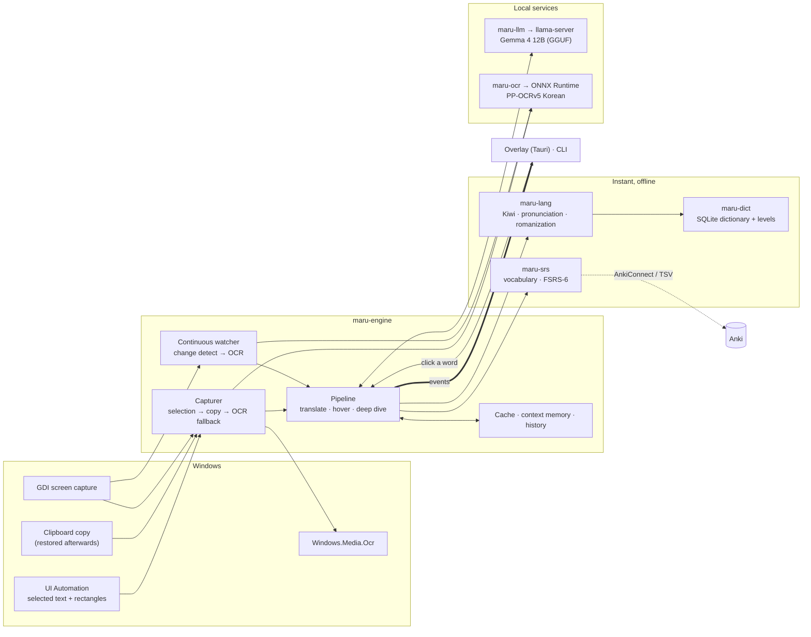

# Architecture

Maru is a small engine with thin front ends. The engine takes a **capture** (text, where it is, which app) and
produces a stream of **events**. The overlay, the CLI and the tests are all just consumers of that stream.

## Crates

| Crate | Responsibility | Why separate |
|---|---|---|
| `maru-core` | types, the `Event` stream, config | everything shares one vocabulary; no heavy dependencies |
| `maru-lang` | Hangul maths, pronunciation + Revised Romanization, Kiwi adapter, 어절 grouping | deterministic, instant, fully unit-testable |
| `maru-dict` | SQLite dictionary, Wiktionary + level importers | data is installed, not bundled |
| `maru-srs` | vocabulary, FSRS-6, Anki | the learning loop's persistence |
| `maru-llm` | streaming client, prompts, demultiplexer, `llama-server` supervisor | the only module that knows the model |
| `maru-ocr` | PP-OCR via ONNX Runtime, word boxes from CTC output | engine behind a trait |
| `maru-platform` | selection, capture, foreground app, Windows OCR behind traits | the only Windows-specific code |
| `maru-engine` | capture fallbacks, pipelines, cache, memory, continuous mode, bootstrap | orchestration without UI |
| `maru-cli` | `maru` command, installers, benchmarks, OCR evaluation | second front end; also the test bench |
| `app/` | Tauri overlay | thin: windows, hotkeys, tray |

## The event contract

For one translation: `Started` → `Breakdown` (offline, instant) → interleaved `Translation` deltas and `Gloss`
events (model, streaming) → `Note` → `Timing`s → `Done`. Errors are events, never panics, and a model failure
still leaves the breakdown and dictionary meanings on screen. Every event carries a request id; a newer
request cancels the older one, and front ends drop events of superseded ids.

## Why it is shaped this way

* **Facts from tools, judgement from the model.** Kiwi and the dictionary supply structure and candidate meanings;
  the model only chooses the meaning that fits the sentence. That makes it faster (short outputs), more accurate,
  and it never invents grammar.
* **Line-oriented model output** (`N|gloss|note`, `POLITE: …`) instead of JSON: it streams, costs fewer tokens,
  and a half-finished answer is still usable.
* **Constant system prompts**, variable context only in the user turn, so the server's prefix cache is hit.
* **Everything optional degrades with a plain-language note** (`maru doctor` lists them).

## Extending it (the avatar and other skills)

Front ends consume `Event`s and call `Engine` methods; nothing in the engine depends on the overlay. A new
capability is a new pipeline in `maru-engine` (screen Q&A reusing the OCR/VLM tier, a writing coach reusing the
LLM client, voice via a speech crate) that emits its own events. The avatar is a front end that listens to the
same stream: the panel is plain HTML, so a Live2D/VRM canvas can sit beside it in the same webview.
