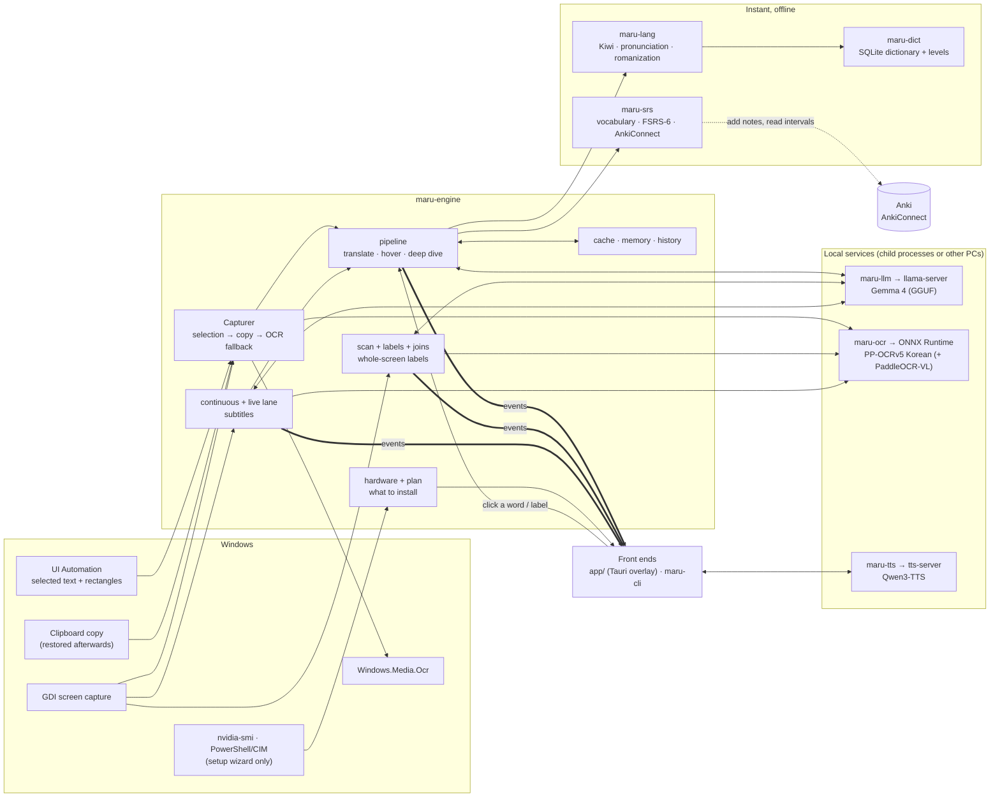

# Architecture

Maru is a small **engine** with thin **front ends**. The engine takes a *capture* (text, where it is, which program)
and produces a stream of **events**. The overlay, the command line and the tests are all consumers of that stream;
nothing in the engine knows about windows, hotkeys or HTML.

This document is the map. If you are about to add or change a feature, read, in this order:
[§2 layering rules](#2-layering-rules) → [§4 feature map](#4-feature-map) (find your feature, or the closest one) →
[§8 extension checklists](#8-extension-checklists). [AGENTS.md](../AGENTS.md) says how to work here without stepping on
anyone; [MANUAL_TESTS.md](MANUAL_TESTS.md) lists what only a real PC can verify.

## 1. The system



Two ideas hold everything together:

* **Facts from tools, judgement from the model.** Kiwi and the dictionary supply structure and candidate meanings; the
  model only chooses what fits the sentence. Faster (short outputs), more accurate, and it never invents grammar.
* **Everything optional degrades with a plain-language note** instead of failing. A missing Kiwi, dictionary, OCR model
  or language model switches one capability off and adds a line to `maru doctor`. A model failure still leaves the
  offline breakdown on screen.

## 2. Layering rules

Dependencies point one way. A crate may use anything above it in this list and nothing below it.

```
maru-core                       types, Event, Config, Paths, settings editing      (no heavy dependencies)
maru-lang  maru-dict  maru-srs  maru-llm  maru-ocr  maru-platform  maru-tts        (each knows only maru-core + its own world)
maru-engine                     orchestration: capture → analyse → translate → learn, setup planning
maru-cli   app/src-tauri        front ends: they call Engine, consume Events, own no business logic
app/ui                          the web pages inside the overlay's windows
```

Rules that keep it that way (and that tests and reviews rely on):

1. **The engine has no UI.** It returns data or an `EventRx`; it never opens a window, registers a key or emits a
   Tauri event. If you need the overlay to know something, add an `Event` or a return value.
2. **Front ends hold no business logic.** `app/src-tauri/src/logic.rs` and the `*-core.js` files hold *decisions* (where
   a panel goes, what a chip offers) as pure functions with tests; `flow.rs` and `commands.rs` only wire.
3. **Platform code is behind traits.** Everything Windows-specific is in `maru-platform/src/windows/` and sits behind
   `SelectionSource` / `ScreenGrabber` (and Windows OCR behind `OcrEngine`), so the engine is testable on Linux with fakes
   (`maru-platform/src/testing.rs`).
4. **The model is only known to `maru-llm`.** Prompts live in `prompts.rs` (constant system prompt, variable context only
   in the user turn, so the server's prefix cache hits). Output formats are line-oriented (`N|gloss|note`), never JSON.
5. **`bridge.js` is the only UI file that knows whether it runs inside Tauri.** Every page works in a plain browser with
   mocked commands (`?demo`), which is how layouts are checked without Windows.
6. **Errors are events, never panics.** Long-running work spawns a task; cancelling means aborting the task's handle.
7. **The Tauri shell is a separate cargo project** (`app/src-tauri`, own lockfile, excluded from the workspace) because
   it needs platform webview libraries the headless crates must not require.

## 3. Repository map

| Path | What lives there |
|---|---|
| `crates/maru-core` | `types.rs` (Capture, Eojeol, ScanItem, Rect…), `event.rs` (the `Event` stream), `config.rs` (every setting, with defaults), `settings.rs` (comment-preserving edits of `config.toml` for the settings page), `paths.rs` (every on-disk location) |
| `crates/maru-lang` | Hangul maths, pronunciation + Revised Romanization, Kiwi adapter + rule-based fallback, 어절 grouping |
| `crates/maru-dict` | SQLite dictionary: Wiktionary and level importers, lookups |
| `crates/maru-srs` | vocabulary store, FSRS-6, AnkiConnect client (`anki.rs`), TSV export |
| `crates/maru-llm` | streaming chat client, prompts, demultiplexer, `llama-server` supervisor, one function per task (`tasks.rs`) |
| `crates/maru-ocr` | PP-OCR through ONNX Runtime, word boxes from CTC output, geometry helpers, the `OcrEngine` trait |
| `crates/maru-platform` | selection, screen capture, foreground app, Windows OCR (all behind traits) + test fakes |
| `crates/maru-tts` | speech: client for `POST /v1/audio/speech`, local `tts-server` supervisor, sentence splitter, disk cache |
| `crates/maru-engine` | the `Engine` and everything it orchestrates (see §5) |
| `crates/maru-cli` | the `maru` binary: translate/explain/bench/doctor/scan/eval-ocr, installers (`setup.rs`), the wizard (`wizard.rs`), TTS tools |
| `app/src-tauri` | the overlay shell: windows, hotkeys, tray, background loops, Tauri commands |
| `app/ui` | plain ES modules, no build step: panel, picker, hub (history/review/status/settings), scan overlay, live band |
| `docs/` | this file, `MANUAL_TESTS.md`, `config.example.toml` (every option, documented) |
| `.github/workflows/` | `ci.yml` (Windows build + tests + node tests; Linux clippy + tests), `tts-server.yml` (builds the speech server) |
| `old/` | the original Python prototype, kept for reference only |

## 4. Feature map

For every feature: how it starts, where it flows, what it persists, how it is configured, and how it is tested.
"Real-PC check" points at [MANUAL_TESTS.md](MANUAL_TESTS.md).

### 4.1 Translate a selection / region (`Ctrl+Alt+T`, `Ctrl+Alt+R`)
* **Flow:** hotkey (`hotkeys.rs`) → `flow::translate_selection` / `translate_region` → `Engine::capture_selection` /
  `capture_region` (`capture.rs`: UI Automation → Ctrl+C → OCR) → `Engine::translate` (`pipeline::translate`) → events →
  `flow::show_capture` forwards them to the panel window as `maru-event`.
* **Events:** `Started → Breakdown → Translation/Gloss (streaming, concurrent) → Note → Timing → Done`.
* **State:** `cache.rs` (repeated lines), `memory.rs` (context lines and history), `annotate.rs` (dictionary + your vocabulary state).
* **UI:** `app/ui/panel.js` (+ `core.js`, pure state), `index.html`, `style.css`. `picker.js` draws the region rectangle.
* **Config:** `[hotkeys]`, `[ui]`, `[capture]`, `[learning].register`, `[llm].context_lines`.
* **Tests:** `crates/maru-engine/tests/pipeline.rs` (event order, cancellation, cache, degraded modes), `app/ui/test/core.test.mjs`.
* **Real-PC check:** M-5 (selection across apps), M-6 (overlay behaviour).

### 4.2 Hover lookup (`Ctrl+Alt+H`)
`watch.rs` detects a pointer resting on a word (`logic.rs::Dwell`) → `Engine::capture_hover` → `Engine::lookup_word`
(offline only, no model) → panel. Config: `[hotkeys].hover`; the dwell time, pointer radius and idle-hide time are constants at the top of `watch.rs`.

### 4.3 Deep dive (click a word)
`commands::deep_dive` → `Engine::deep_dive` (`pipeline::deep_dive`): dictionary entries, how the form is built
(`DeepEntries`), streamed explanation sections (`DeepDelta`). Looking a word up records the lookup in `maru-srs`
(`WordState` events), which feeds fading and review.

### 4.4 The learning loop
`maru-srs`: `store.rs` (vocabulary, lookups, saved/known state), `fsrs.rs` (scheduler, verified against the reference
vectors), `anki.rs` (AnkiConnect). Engine side: `anki_flow.rs` (deck suggestions per program, tags, what happens on add),
`Engine::{save_word, set_known, review_word, due_words…}`. A word is queued for review after the second lookup
(`auto_save_after_lookups`); words held long enough **fade** from the panel (`known_stability_days`, or Anki's interval
read back every `refresh_minutes` by `watch::spawn_anki_refresh`).
* **Commands:** `anki_overview`, `anki_add`, `anki_add_example`, `anki_sync`, `anki_check`, `anki_due`, `save_word`, `set_known`, `review_word`, `due_words`, `recent_words`, `word_contexts`.
* **UI:** `anki.js` (pure rules for the Add-to-Anki popover), `panel.js`, `hub.js` (Review tab), Settings → Anki.
* **Config:** `[learning]`, `[learning.anki]`, per-program decks/tags in `[[profile]]`.
* **Tests:** FSRS vectors, `anki.rs` against a fake AnkiConnect, `anki_flow.rs`, `anki.test.mjs`.
* **Real-PC check:** M-9 (real Anki and AnkiConnect — never run against the real thing yet).

### 4.5 Screen scan: label everything on screen (`Ctrl+Alt+S`)
* **Flow:** `flow::scan_screen` → `Engine::scan` (`scan::run`): grab the screen → OCR (`scan_ocr`, the plain detector at full
  resolution) → `found_items` (Hangul only, confidence, de-duplication) → remembered joins applied (`joins::apply_rules`) →
  `label()`: dictionary/glossary/remembered labels at once (`ScanItems`), the rest from the model in batches
  (`ScanLabel`, streamed) → `Done`. Labels are remembered per program (`labels.rs`).
* **Events:** `ScanStarted → ScanItems → ScanLabel* → Timing* → Done`, forwarded to the scan window as `maru-scan`.
* **The program ("scope")** is the foreground `.exe` at scan start, stored in `Inner::scan_scope` with the scan id,
  *not* looked up later: clicking the overlay can change which window is in front.
* **UI:** `app/ui/scan.js` (+ `layout.js` placement, `scan-core.js` join helpers), `scan.html`, `scan.css`. The overlay
  window is click-through except over labels: `scan.js::report()` tells the shell where the labels (and the Join chip) are
  (`scan_labels`), and the shell turns hit-testing on only when the pointer is over one (`logic::over_label`).
* **Config:** `[learning].gloss_mode`, `[[profile]]` (`glossary`, `hint`, `gloss_mode`), `[ocr]`, `lite`.
* **Tests:** `pipeline.rs` `mod scan`, `labels.rs`, `layout.test.mjs`, `scan-core.test.mjs`. `maru scan <screenshot>` runs the same
  pipeline from the command line.
* **Real-PC check:** M-4.

### 4.6 Manual join of scan labels (Shift+click, Join / Split)
Fixes a phrase the OCR detector cut into two boxes. `joins.rs` is pure: `reading_order`, `join_pieces` (text and one box;
a gap under a quarter of the text height means one word), `follows` ("next to each other"), `apply_rules`. Joins are stored
in `labels.db` (`joins` table, scope = program) and re-applied by the next scan of that program only when the pieces sit
next to each other. `Engine::scan_join(scan_id, item, pieces)` builds the item and labels it through the same `scan::label`
path; `Engine::forget_join` backs Split. A join on a scan that is no longer current is refused with an `Error` event.
UI state (selection, pending joins, the chip) is in `scan.js`; the commands are `scan_join` / `scan_unjoin`.
* **Tests:** `joins.rs`, `labels.rs`, `pipeline.rs` (end-to-end: join, remember, forget, stale scan, other program), `scan-core.test.mjs`.
* **Real-PC check:** M-4.

### 4.7 Live subtitles (`Ctrl+Alt+C`, `Ctrl+Alt+Shift+C` to choose the area)
* **Watcher** (`continuous.rs`, `change.rs`): looks at a fixed region every `interval_ms`; a picture that stopped moving
  (`stable_ms`) or two agreeing reads is a finished line, read at once; a fading line is read sooner; a moving scene without
  text is polled slowly; one-character OCR jitter is ignored. It emits `LiveEvent::Line(LiveLine)` and `LiveEvent::Cleared`
  (the original line is gone). It reports its own stage timings to the log.
* **Live lane** (`Engine::translate_live`): *translation only*, with the earlier lines (`Inner::live_turns`, `context_lines`)
  sent as chat turns, a short answer cap and low temperature (`maru-llm` `translate_live`, `prompts::ko_en_live`). It has its
  own cache and never touches the normal translation's cache or memory. Every line also goes into the history
  (`HistoryItem` with `live`, `first_ms`, `total_ms`).
* **Shell** (`flow::start_continuous`): builds the band window geometry (`logic::band_window`, `band_cover`), keeps only the
  newest line drawn (`AppState::live_latest`), emits `maru-live` (a `LiveBand`), `maru-live-clear`, `maru-live-off` to the live window.
* **UI:** `live.js` (+ `live-core.js`: `bandStyle`, the `createBand` state machine, `latencyText`), `live.html`, `live.css`.
  The window is created hidden, click-through, never focused, and excluded from screen capture so OCR never reads the translation back.
  `live_idle` hides it after the fade. History → Live subtitles (`hub.js`) shows the lines in order with latency.
* **Config:** `[continuous]` (`interval_ms`, `stable_ms`, `linger_ms`, `context_lines`, `history_len`, `region`).
* **Tests:** `continuous.rs`, `change.rs`, `pipeline.rs` (live lane tests), `logic.rs`, `live.test.mjs`, `prompts.rs`.
* **Real-PC check:** M-3.

### 4.8 Speech (TTS)
`maru-tts` (`Tts`: split into sentences → disk cache → provider → remember). Providers: the local `tts-server`
(qwentts.cpp running Qwen3-TTS, built by `.github/workflows/tts-server.yml`, supervised by `local.rs`, started by
`bootstrap.rs`) or any OpenAI-style speech endpoint (`provider = "endpoint"`, e.g. a second PC). The panel reads sentence by
sentence with the next one prepared while one plays (`app/ui/reader.js`, pure queue logic). Commands: `tts_test`, `tts_plan`,
`tts_clip`, `tts_reading`. CLI: `maru setup tts`, `maru tts`, `maru tts-eval`. Anki cards use it for audio (`[learning.anki].audio`).
* **Config:** `[tts]`; `run_in_lite = false` keeps the local voice off in lite mode so a game keeps the GPU.
* **Tests:** `maru-tts` (splitter, cache, client against a scripted server), `reader.test.mjs`.
* **Real-PC check:** M-8.

### 4.9 Settings
`settings::get_settings` / `save_settings` (app shell) → `maru_core::settings::patch`: applies only what changed to the *text* of
`config.toml` with `toml_edit` (comments and unknown keys survive), re-parses, validates (`settings::validate`), and reports
which changes need a restart (`applies_live`: hotkeys and `ui.*` only). The page is described by `app/ui/settings-core.js` (a
schema of fields by dotted config path) and drawn by `settings.js`. **Adding a setting means touching `config.rs`,
`config.example.toml`, `settings-core.js` and, if it validates, `settings.rs`** (§8).

### 4.10 Setup wizard and installers (`maru setup`)
* `maru-engine::hardware`: reads `nvidia-smi` and one PowerShell/CIM probe (GPUs, driver CUDA version, memory, free disk);
  parsers are separate from process calls and tested with real command output.
* `maru-engine::plan`: pure `recommend(&Hardware) -> Plan` (backend CUDA/Vulkan/CPU, full or small model, reading model,
  reasons, warnings), `steps`, download sizes, `disk_warning`, `config_changes`. No I/O — the app's future first-run page reuses it.
* `maru-cli::wizard`: `decide` (questions through a `Ui` trait: `Terminal`, `Automatic` for `--yes`/`--dry-run`, scripted in
  tests) → `apply_config` (edits `config.toml` in place) → `execute` (runs the installers in `setup.rs`/`tts.rs`; each skips
  what is installed; a failure does not stop the others) → `maru doctor --deep`. End of input aborts.
* `setup.rs`: llama.cpp release picking (backend, newest CUDA the driver can run, `--force` clears old files), Kiwi, OCR models,
  Hugging Face downloads. The model on another PC is **not** part of the wizard: it is Settings → Translation model (`[llm].endpoint`).
* **Tests:** `hardware.rs`, `plan.rs`, `wizard.rs`, `setup.rs`, `main.rs` (`cli_tests`).
* **Real-PC check:** M-1, M-2.

### 4.11 OCR tiers and the lite profile
`maru-ocr::OcrEngine` has PP-OCR (`paddle.rs`), Windows OCR (platform crate) and, in the engine, a vision reader
(`vlm_ocr.rs`, `vision.rs`: PaddleOCR-VL through its own `llama-server`) combined with PP-OCR by `hybrid_ocr.rs`
(PP-OCR gives lines and positions, the reader gives better letters; matched by text). `respace.rs` restores dropped spaces.
`lite = true` (`Config::effective`, also `MARU_LITE=1`) turns the reading model off and swaps in the smaller translation model
and one slot, for use beside a game. `bootstrap.rs` assembles all of this from what is installed.

### 4.12 Per-program behaviour
`[[profile]]` entries match the foreground `.exe` (`Config::profile_for`): a `glossary` (fixed translations, never sent to the
model), a `hint` for the prompts, `register`, `gloss_mode`, and Anki deck/tags.

## 5. Inside `maru-engine`

| Module | Responsibility |
|---|---|
| `engine.rs` | the public `Engine`, `EngineParts` (everything it is built from, replaceable in tests), private `Inner` shared state |
| `bootstrap.rs` | assemble an `Engine` from what is installed; start `llama-server`, `tts-server`, the vision reader; notes for `maru doctor` |
| `pipeline.rs` | translate, hover lookup, deep dive; `Emitter` |
| `capture.rs` | selection → copy → OCR fallback; region and hover capture |
| `annotate.rs` · `cache.rs` · `memory.rs` | offline enrichment · repeated-line cache · context lines and history |
| `scan.rs` · `labels.rs` · `joins.rs` | screen scan · remembered labels and joins (SQLite) · manual join logic |
| `continuous.rs` · `change.rs` | live-subtitle watcher · cheap change detection and text similarity |
| `anki_flow.rs` | deck suggestions, tags, add flow |
| `hybrid_ocr.rs` · `vlm_ocr.rs` · `vision.rs` · `respace.rs` | OCR second opinion and repair |
| `hardware.rs` · `plan.rs` | what this PC has · what to install on it |

## 6. Contracts

### 6.1 The event stream (`maru-core/src/event.rs`)
Every event is JSON `{"type": "snake_case_name", …}` and carries the request `id`. Front ends keep the latest id per kind of
request and drop events of older ids, which is how superseded requests are cancelled without races.

| Request | Order |
|---|---|
| translate | `Started` → `Breakdown` (offline) → `Translation`/`TranslationDone`/`Gloss` (streaming, interleaved) → `Note` → `Timing`s → `Done` |
| hover | `Started` → `Breakdown` → `Timing` → `Done` (no model) |
| deep dive | `WordState` (the lookup was recorded) → `DeepEntries` → `DeepDelta`s → `Done` |
| scan | `ScanStarted` → `ScanItems` → `ScanLabel`s → `Timing`s → `Done` |
| scan join | `ScanItems` (the one new item, with the number the overlay chose) → `ScanLabel`? → `Done`, all under the *scan's* id; or `Error` → `Done` |
| live line | the translate events, without `Breakdown`/`Gloss` |

Rules for changing events: **add variants, do not repurpose or reorder existing ones**; every consumer must tolerate a variant it
does not know (the overlay ignores unknown `type`s); update `Event::id`, the round-trip test in `event.rs`, `app/ui` consumers and
this table in the same change. Errors are `Error { id, stage, message }` followed by `Done`.

### 6.2 Engine ↔ front end
`Engine` methods return `(id, EventRx)` (or `EventRx`, or plain data). Each long request kind has a **task slot** in `Inner`
(`translate_task`, `deep_task`, `scan_task`; the translation cache is in memory — `Paths::cache_db` exists but is unused): starting a new one aborts the old one. Scan joins and live lines do **not** use a
slot that would cancel a scan (joins are detached; live lines have their own lane). Anything that must outlive a request
(remembered labels, vocabulary) is written by the task itself.

### 6.3 Shell ↔ pages
* **Windows** (labels in `windows.rs`): `panel` (`index.html`), `picker`, `hub`, `scan`, `live`. Adding one needs a capability entry in
  `app/src-tauri/capabilities/default.json`.
* **Shell → page events:** `maru-event`, `maru-notice`, `maru-auto-deep`, `maru-auto-speak`, `maru-tts-control`, `maru-config`,
  `maru-hidden` (panel); `maru-scan`, `maru-scan-clear` (scan); `maru-live`, `maru-live-clear`, `maru-live-off` (live); `maru-tab` (hub).
* **Page → shell:** Tauri commands in `commands.rs` / `settings.rs`, registered in the `generate_handler!` list in `main.rs`. JS passes
  camelCase argument names (`scanId`), Rust receives snake_case (`scan_id`).
* **Click-through windows** (scan, live) never take focus; the shell decides per pointer position whether the scan window accepts the
  click, from the rectangles the page reports.
* The shell's `AppState` (`state.rs`) is the only shared mutable state; the pure decisions are in `logic.rs`.

### 6.4 Persistence
| File (under the data dir unless noted) | Owner | Content |
|---|---|---|
| `config.toml` (config dir) | `maru-core::config`, `settings.rs` | every setting; comments are preserved on edit |
| `vocab.db` | `maru-srs` | words, lookups, states, FSRS fields, contexts, Anki intervals |
| `dict.db` | `maru-dict` | dictionary entries, inflected forms, levels |
| `labels.db` | `maru-engine::labels` | remembered scan labels `(scope, text)` and joins `(scope, parts)`; `scope` = program `.exe` |
| `models/` | installers | OCR, reading model, TTS models; GGUF models are cached by `llama-server` |
| `bin/` | `setup llm` | llama.cpp (**loose files only**; `kiwi/` and `tts/` are subfolders and must never be mixed in — their DLLs would replace llama.cpp's) |
| `tts-cache/` | `maru-tts` | spoken sentences |
| `maru-app.log` | `app/src-tauri/main.rs` | the overlay's log (previous run in `maru-app.previous.log`) |

`MARU_HOME` relocates everything (`config.toml`, `data`, `models`, `bin`); tests and `--home` use `Paths::under`.

## 7. Concurrency, cancellation, speed
* The engine runs on a Tokio runtime owned by the front end; blocking work (GDI, ONNX, SQLite) goes through `spawn_blocking`.
* Translation and per-word meanings are requested at the same time on separate model slots. The offline breakdown is shown before any
  model call. The model server is started at launch, kept warm, with a constant system prompt and `--cache-reuse`; thinking is off.
* Selecting text is read exactly through UI Automation (no OCR error); OCR is the fallback.
* Live lines never wait for a picture to stop moving; scan labels are batched (`BATCH` strings per request, two requests in flight).

## 8. Extension checklists

**A new pipeline or capability** (e.g. screen Q&A, a writing coach): add a module in `maru-engine`, an `Engine` method that returns
`EventRx`, a task slot in `Inner` *only if* a newer request should cancel an older one, new `Event` variants (§6.1), tests in
`tests/pipeline.rs` with the scripted model server, then the front-end wiring. It reuses `maru-llm` and `maru-ocr`; it does not reach
into other pipelines.

**A new event:** `event.rs` (variant, `id()`, round-trip test) → producer → every consumer (`app/ui`, `maru-cli/src/render.rs`) → §6.1.

**A new Tauri command:** function in `commands.rs` (thin: call `Engine`/`flow`) → register in `main.rs` → call it from the page → mock it
in the page's browser demo block if the page has one.

**A new window:** `windows.rs` (constant + `create_*`; transparent, focusless windows set `content_protected`) → `capabilities/default.json`
→ html/css/js in `app/ui` with a pure `*-core.js` and a `node --test` file → add that file to the list in `.github/workflows/ci.yml`.

**A new setting:** `config.rs` (field + default) → `docs/config.example.toml` (documented; `the_example_config_in_the_docs_parses` in `config.rs` parses it and checks key values, so keep it valid) → `settings-core.js` (the field) → `settings.rs`/`settings::validate` if it has limits → decide live vs restart (`applies_live`).

**A new hotkey:** `config.rs::Hotkeys` + example + settings field → `hotkeys.rs` → tray entry in `main.rs::tray_menu` → README table.

**A new installer step:** a function in `maru-cli/src/setup.rs` (or its own file) that is idempotent → a subcommand in `main.rs` → a
`Step` in `maru-engine::plan` with a size estimate → `wizard.rs::run_step`.

**Windows-only code:** behind a trait in `maru-platform`, with a fake in `testing.rs`; it only type-checks on Linux CI, so say what
needs a real machine in `MANUAL_TESTS.md`.

**UI logic:** pure function in a `*-core.js` file, unit-tested with `node --test`; the DOM file only draws.

## 9. Build, CI and environment notes
* Workspace: `cargo test --workspace`; app: `cargo test --manifest-path app/src-tauri/Cargo.toml` (separate lockfile and `target/`).
  Linux needs `libwebkit2gtk-4.1-dev libayatana-appindicator3-dev librsvg2-dev libxdo-dev libssl-dev` for the app crate.
* CI: Windows (`cargo build`/`test` for workspace and app, `node --test` over an explicit file list) and Linux (clippy with
  `-D warnings`, tests, app `cargo check`). **A new `*.test.mjs` file must be added to the list in `ci.yml`.**
* ONNX Runtime is downloaded and linked at build time on Windows; a Visual Studio C++ toolset that is too old fails to link with
  `unresolved external symbol __std_…` — update the Build Tools.
* `target/` directories reach tens of GB; deleting them is always safe.

## 10. Known limits and decisions
* Pronunciation rules that need morpheme knowledge (ㄴ-insertion in compounds, 사이시옷) are not guessed.
* Word meanings in context come from the model, so they are only as good as the model.
* Scan joins apply only to pieces that sit next to each other; there is deliberately no automatic merge of detector boxes (tight menus
  and inventory grids would be glued together wrongly).
* Vision models return text without positions, so they are a second opinion, not a replacement for PP-OCR's geometry.
* An avatar or other skills are front ends or new pipelines in the same shape: listen to the same events, call `Engine`.
