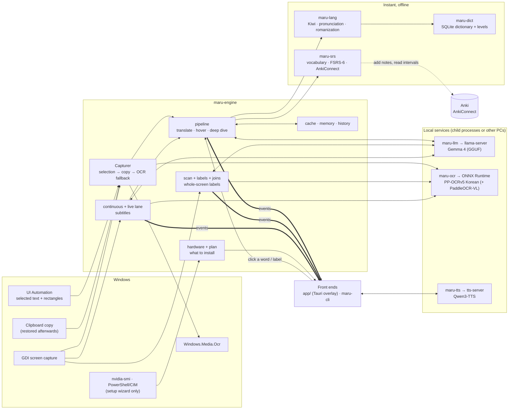

# Architecture

Maru is a small **engine** with thin **front ends**. The engine takes a *capture* (text, where it is, which program)
and produces a stream of **events**. The overlay, the command line and the tests are all consumers of that stream;
nothing in the engine knows about windows, hotkeys or HTML.

This document is the map. If you are about to add or change a feature, read, in this order:
[§2 layering rules](#2-layering-rules) → [§4 feature map](#4-feature-map) (find your feature, or the closest one) →
[§8 extension checklists](#8-extension-checklists). [AGENTS.md](../AGENTS.md) says how to work here without stepping on
anyone; [MANUAL_TESTS.md](MANUAL_TESTS.md) lists what only a real PC can verify.

## 1. The system



Two ideas hold everything together:

* **Facts from tools, judgement from the model.** Kiwi and the dictionary supply structure and candidate meanings; the
  model only chooses what fits the sentence. Faster (short outputs), more accurate, and it never invents grammar.
* **Everything optional degrades with a plain-language note** instead of failing. A missing Kiwi, dictionary, OCR model
  or language model switches one capability off and adds a line to `maru doctor`. A model failure still leaves the
  offline breakdown on screen.

## 2. Layering rules

Dependencies point one way. A crate may use anything above it in this list and nothing below it.

```
maru-core                       types, Event, Config, Paths, settings editing      (no heavy dependencies)
maru-lang  maru-dict  maru-srs  maru-llm  maru-ocr  maru-platform  maru-tts        (each knows only maru-core + its own world)
maru-engine                     orchestration: capture → analyse → translate → learn, setup planning
maru-cli   app/src-tauri        front ends: they call Engine, consume Events, own no business logic
app/ui                          the web pages inside the overlay's windows
```

Rules that keep it that way (and that tests and reviews rely on):

1. **The engine has no UI.** It returns data or an `EventRx`; it never opens a window, registers a key or emits a
   Tauri event. If you need the overlay to know something, add an `Event` or a return value.
2. **Front ends hold no business logic.** `app/src-tauri/src/logic.rs` and the `*-core.js` files hold *decisions* (where
   a panel goes, what a chip offers) as pure functions with tests; `flow.rs` and `commands.rs` only wire.
3. **Platform code is behind traits.** Everything Windows-specific is in `maru-platform/src/windows/` and sits behind
   `SelectionSource` / `ScreenGrabber` (and Windows OCR behind `OcrEngine`), so the engine is testable on Linux with fakes
   (`maru-platform/src/testing.rs`).
   Resource counters are behind `maru-platform::resources::ResourceMonitor`; unsupported platforms retain missing readings.
4. **The model is only known to `maru-llm`.** Prompts live in `prompts.rs` (constant system prompt, variable context only
   in the user turn, so the server's prefix cache hits). Output formats are line-oriented (`N|gloss|note`), never JSON.
5. **`bridge.js` is the only UI file that knows whether it runs inside Tauri.** Every page works in a plain browser with
   mocked commands (`?demo`), which is how layouts are checked without Windows.
6. **Errors are events, never panics.** Long-running work spawns a task; cancelling means aborting the task's handle.
7. **The Tauri shell is a separate cargo project** (`app/src-tauri`, own lockfile, excluded from the workspace) because
   it needs platform webview libraries the headless crates must not require.

## 3. Repository map

| Path | What lives there |
|---|---|
| `crates/maru-core` | `types.rs` (Capture, Eojeol, ScanItem, Rect…), `event.rs` (the `Event` stream), `config.rs` (every setting, with defaults), `settings.rs` (comment-preserving edits of `config.toml` for the settings page), `paths.rs` (every on-disk location) |
| `crates/maru-lang` | Hangul maths, pronunciation + Revised Romanization, Kiwi adapter + rule-based fallback, 어절 grouping |
| `crates/maru-dict` | SQLite dictionary: Wiktionary and level importers, lookups |
| `crates/maru-srs` | vocabulary store, FSRS-6, AnkiConnect client (`anki.rs`), TSV export |
| `crates/maru-llm` | streaming chat client, prompts, demultiplexer, `llama-server` supervisor, one function per task (`tasks.rs`) |
| `crates/maru-ocr` | PP-OCR through ONNX Runtime, word boxes from CTC output, geometry helpers, the `OcrEngine` trait |
| `crates/maru-platform` | selection, screen capture, foreground app, Windows OCR (all behind traits) + test fakes |
| `crates/maru-tts` | speech: client for `POST /v1/audio/speech`, local `tts-server` supervisor, sentence splitter, disk cache |
| `crates/maru-engine` | the `Engine` and everything it orchestrates (see §5) |
| `crates/maru-cli` | the `maru` binary: translate/explain/bench/doctor/scan/eval-ocr, installers (`setup.rs`), the wizard (`wizard.rs`), TTS tools |
| `app/src-tauri` | the overlay shell: windows, hotkeys, tray, background loops, Tauri commands |
| `app/ui` | plain ES modules, no build step: panel, picker, hub (history/review/status/settings), scan overlay, live band |
| `docs/` | this file, `MANUAL_TESTS.md`, `config.example.toml` (every option, documented) |
| `.github/workflows/` | `ci.yml` (Windows build + tests + node tests; Linux clippy + tests), `tts-server.yml` (builds the speech server) |
| `old/` | the original Python prototype, kept for reference only |

## 4. Feature map

For every feature: how it starts, where it flows, what it persists, how it is configured, and how it is tested.
"Real-PC check" points at [MANUAL_TESTS.md](MANUAL_TESTS.md).

### 4.1 Translate a selection / region (`Ctrl+Alt+T`, `Ctrl+Alt+R`)
* **Flow:** hotkey (`hotkeys.rs`) → `flow::translate_selection` / `translate_region` → `Engine::capture_selection` /
  `capture_region` (`capture.rs`: UI Automation → Ctrl+C → OCR) → `Engine::translate` (`pipeline::translate`) → events →
  `flow::show_capture` forwards them to the panel window as `maru-event`.
* **Events:** `Started → Breakdown → Translation/Gloss (streaming, concurrent) → Note → Timing → Done`.
* **State:** `cache.rs` (repeated lines), `memory.rs` (context lines and history), `annotate.rs` (dictionary + your vocabulary state).
  Cache entries track translation and gloss completion separately. A validated translation can replay immediately while
  missing eligible meanings are retried; fresh vocabulary annotation decides which words still need them. Failed streams
  never populate translation cache, memory or history, even if an English-to-Korean variant closed before the error.
  `maru-llm/client.rs` bounds response-header and idle waits, rejects malformed/capped/incomplete streams, and checks EOF
  errors. The English-to-Korean follow-up sender is closed when translation finishes, including a missing register.
  Only the private one-token warm-up path permits an intentional token-limit stop; it still validates stream completion
  and produces no reusable answer. Ordinary translation/gloss/deep-dive requests remain strict.
* **UI:** `app/ui/panel.js` (+ `core.js`, pure state), `index.html`, `style.css`. `picker.js` draws the region rectangle.
* **Config:** `[hotkeys]`, `[ui]`, `[capture]`, `[learning].register`, `[llm].context_lines`.
* **Tests:** `crates/maru-engine/tests/pipeline.rs` (event order, cancellation, cache, degraded modes), `app/ui/test/core.test.mjs`.
* **Real-PC check:** M-5 (selection across apps), M-6 (overlay behaviour).

### 4.1a Saved game reading areas (Read again / opt-in Auto-read)

* **Flow:** floating controls / Reading areas hub / optional `hotkeys.reading_again` → shell `reading.rs` →
  `Engine` methods in `reading_areas.rs`. `reading_store.rs` owns a separate SQLite store and `reading_change.rs`
  confirms identical OCR text at least 650 ms apart. A 300 ms poll fingerprints cropped frames; a periodic two-second
  OCR check catches small changes or moving backgrounds. It uses normal snapshot OCR and `Engine::translate`,
  retaining model routing, exact OCR corrections, cache, breakdown, glosses and per-word deep dives.
* **State:** one active translation and one replaceable latest pending capture. Generations reject superseded results
  and older errors; returning from another app resets confirmation before capturing. Manual capture calls are gated.
  Manual capture and pending manual text take priority over automatic observation, including while Maru owns focus.
  While Maru controls own focus, an active manual or automatic answer finishes without observing/capturing controls;
  new game paragraphs can still replace pending text after game focus returns. Unrelated-app focus rules remain unchanged.
  Hold status exposes actual manual capture/queue/translation/error phases; canceling a capture through Hold or a word
  interaction clears its discarded phase so Resume can watch again. `busy` continues to mean an active translation.
  Hold pauses watching and retains the current stream through completion; deep dive/editor interactions hold it.
  Another snapshot explicitly supersedes it. Empty confirmed text
  retains the last answer. Automatic mode and all pending/active/status state are transient and start off.
* **Areas:** named per executable, normalized against a visible game client rectangle. Window movement follows the
  area; size changes require explicit check/reposition. The existing picker outlines a saved/scaled area and accepts
  Enter to retain it, a drag to replace it, or Esc to cancel. A changed window during selection/capture is refused.
  Shared emulator executables require distinct area names and manual selection.
* **Platform:** additive `ScreenGrabber::app_window` has a default unsupported result. `app_window_by_id(exe,identity)`
  defaults to filtering the older lookup; Windows re-inspects the exact HWND, including after picker focus changes.
  New picks refresh current geometry instead of relying on the manager's cached rectangle. `AppWindow` reports executable,
  title, client rectangle and transient identity. The Windows implementation owns visible/non-minimized window lookup;
  no Win32 call enters the engine/shell.
* **UI:** `reading.js`, `reading-core.js`, `reading.css`, `reading-demo.js` add the hub manager, floating selector/buttons
  and snapshot status/hold banner. Floating rectangles include these controls through the existing menu rectangle.
  Shell `reading_feedback.rs` and `reading-progress{,-core}.js` / `reading-progress.html/css` show manual acknowledgement
  before OCR finishes: capturing, queued, reading, done or error. The protected, noninteractive `reading-progress` window
  uses `Engine::reading_area_rect` to anchor against the known game, never another same-executable helper. Operation IDs
  reject stale updates; readiness gates first show. Done expires after six seconds; errors persist until retry/Dismiss.
  Existing Dismiss hides this feedback without canceling the reading. The manual answer is protected from panel idle-hide
  while the operation and its brief completion feedback remain active; the existing pin provides longer retention.
* **Tests:** `tests/pipeline.rs` includes `support/reading_areas.rs` (scripted model and fake windows/OCR);
  `reading_change.rs` tests text settling; `app/ui/test/reading.test.mjs` covers controls, stale selection and DPI preview.
  Slow-OCR regressions cover manual/automatic overlap and held progress. Shell/UI tests cover progress IDs and phases.
  Chromium demos check layout and interaction. Real Windows/game/capture quality checks: M-30 and M-32.

### 4.2 Hover lookup (`Ctrl+Alt+H`)
`watch.rs` detects a pointer resting on a word (`logic.rs::Dwell`) → `Engine::capture_hover` → `Engine::lookup_word`
(offline only, no model) → panel. Config: `[hotkeys].hover`; the dwell time, pointer radius and idle-hide time are constants at the top of `watch.rs`.

### 4.3 Deep dive (click a word)
`commands::deep_dive` → `Engine::deep_dive` (`pipeline::deep_dive`): dictionary entries, how the form is built
(`DeepEntries`), streamed explanation sections (`DeepDelta`). Looking a word up records the lookup in `maru-srs`
(`WordState` events), which feeds fading and review.

### 4.4 The learning loop
`maru-srs`: `store.rs` (vocabulary, lookups, saved/known state), `fsrs.rs` (scheduler, verified against the reference
vectors), `anki.rs` (AnkiConnect). Engine side: `anki_flow.rs` (deck suggestions per program, tags, what happens on add),
`Engine::{save_word, set_known, review_word, due_words…}`. A word is queued for review after the second lookup
(`auto_save_after_lookups`); words held long enough **fade** from the panel (`known_stability_days`, or Anki's interval
read back every `refresh_minutes` by `watch::spawn_anki_refresh`).
* **Commands:** `anki_overview`, `anki_add`, `anki_add_example`, `anki_sync`, `anki_check`, `anki_due`, `save_word`, `set_known`, `review_word`, `due_words`, `recent_words`, `word_contexts`.
* **UI:** `anki.js` (pure rules for the Add-to-Anki popover), `panel.js`, `hub.js` (Review tab), Settings → Anki.
* **Config:** `[learning]`, `[learning.anki]`, per-program decks/tags in `[[profile]]`.
* **Tests:** FSRS vectors, `anki.rs` against a fake AnkiConnect, `anki_flow.rs`, `anki.test.mjs`.
* **Real-PC check:** M-9 (real Anki and AnkiConnect — never run against the real thing yet).

Anki adds are reserved and validated through `anki_add.rs` before the shell asks speech to generate media. The permit
spans preflight, audio and the add; refresh shares its gate so it cannot overwrite membership from a concurrent add.
`anki_store.rs` adds membership independent of the local saved queue and incomplete-add records keyed by word, endpoint
and note type. Known post-creation failures return an additive `warning` and can finish the same note on retry/restart.
Full successful refreshes reconcile missing and suspended cards atomically; failed/incomplete API reads preserve old
progress. Local saved/known/FSRS columns keep their meaning. `anki_refresh` is an explicit Settings command; Status adds
`anki_words`. Pure UI rules remain in `anki.js`; recovery/refresh integration tests are in `tests/pipeline.rs`, persistence
tests in `anki_store.rs`. Real collection/AnkiWeb and audio checks: M-24.

### 4.5 Screen scan: label everything on screen (`Ctrl+Alt+S`)
* **Flow:** `flow::scan_screen` → `Engine::scan` (`scan::run`): grab the screen → OCR (`scan_ocr`, the plain detector at full
  resolution) → `found_items` (Hangul only, confidence, de-duplication) → remembered joins applied (`joins::apply_rules`) →
  `label()`: dictionary/glossary/remembered labels at once (`ScanItems`), the rest from the model in batches
  (`ScanLabel`, streamed) → `Done`. Labels are remembered per program (`labels.rs`).
* **Events:** `ScanStarted → ScanItems → ScanLabel* → Timing* → Done`, forwarded to the scan window as `maru-scan`.
* **The program ("scope")** is the foreground `.exe` at scan start, stored in `Inner::scan_scope` with the scan id,
  *not* looked up later: clicking the overlay can change which window is in front.
* **UI:** `app/ui/scan.js` (+ `layout.js` placement, `scan-core.js` join helpers), `scan.html`, `scan.css`. The overlay
  window is click-through except over labels: `scan.js::report()` tells the shell where the labels (and the Join chip) are
  (`scan_labels`, with the current scan ID), and the shell turns hit-testing on only when the pointer is over one
  (`logic::over_label`). Right-click opens correction/hide options; the menu rectangle is included in hit-testing.
  Whole-label left-click opens the explanation, except in explicit join mode or with Shift held. Hover edit/delete buttons
  are removed. `context-menu*.js/css` is shared with the snapshot panel; menus clamp/reposition inside their window.
  `scan-status-core.js` chooses loading/ready/failed/unavailable state; `scan-status.js/css` paints pulsing dots,
  amber `!` and static `?`, with status/error tooltips and reduced-motion support. Available translations remain visible.
  `ScanLabelsFinished` ends waiting for listed item IDs only, so another scan/join/correction sharing the scan ID
  keeps its own loading state. Old scan IDs remain ignored; `Done` alone never settles unrelated labels.
* **Config:** `[learning].gloss_mode`, `[[profile]]` (`glossary`, `hint`, `gloss_mode`), `[ocr]`, `lite`.
* **Tests:** `pipeline.rs` `mod scan`, `labels.rs`, `layout.test.mjs`, `scan-core.test.mjs`, `context-menu.test.mjs`, `scan-status.test.mjs`.
  Shell `ScanState` tests cover hidden/replaced scans; `launcher.test.mjs` covers conditional controls. `maru scan <screenshot>` runs the same
  pipeline from the command line.
* **Real-PC check:** M-4, M-28 (loading, failure and no-result states).

Snapshot OCR correction is in `ocr_corrections.rs`: a current region capture or current scan item can be edited and
translated again without capture/OCR. Snapshot edits preserve the original program and region, clear old word boxes
and retain the original raw OCR across repeated edits. Scan edits reserve new item IDs (including in-flight joins),
so late model answers for an old item cannot replace a corrected label. Scope is captured before screen/region OCR.
Optional exact rules live in an additive `ocr_corrections` table in `labels.db`, with no cross-program or substring
fallback. They apply to manual region/scan/lookup snapshots, never to continuous OCR. The lazy, focusable, protected
`correction` window is wired by `app/src-tauri/src/correction.rs`; `correction*.{html,css,js}` implements its browser demo.
Entry points are right-click → Correct Korean OCR… in the panel and scan labels. This edits Korean OCR only, then
regenerates the English through the existing pipeline. Hiding a scan label is a separate right-click action.
Tests: `ocr_corrections.rs`, `tests/pipeline.rs`, `core.test.mjs`, `correction.test.mjs`. Real-game interaction: M-25, M-27.

### 4.6 Manual join and separation of scan labels (Join words or Shift+click)
Fixes words or a sentence the OCR detector cut into several boxes. Joins are stored in `labels.db`, scoped to the
program, and recalled only when pieces sit next to each other. `joins.rs` supplies reading order and adjacency;
the interactive composition and restoration are in `scan_joining.rs`. All labels use the same `scan::label` path.
Selection, pending joins, reserved IDs and the chip/menu are in `scan.js` with pure decisions in `scan-core.js`.
The floating menu shows Join words and Refresh labels only while screen labels are visible. `scan_controls.rs` toggles
the display and shares transient join mode through `ScanState`/`maru-scan-join-mode`; `scan_join_mode` acknowledges page
changes. Successful joining returns to ordinary clicks; cancel/toggle-off clears selection. Late mode replies, stale
scan starts and old hide notifications cannot replace newer state. The floating Label screen action hides an active
scan; Refresh labels, the tray and the existing scan hotkey explicitly rescan. Model prompts are unchanged.
* **Tests:** `joins.rs`, `labels.rs`, `pipeline.rs` (end-to-end: join, remember, forget, stale scan, other program), `scan-core.test.mjs`.
* **Real-PC check:** M-4, M-29.

Interactive joins use `scan_joining.rs` / `Engine::join_scan_items`: current item IDs, reading order, spaces by default,
or explicit One word. `ScanItem.join` retains original boxes, exact rule keys and spacing intent. `apply_saved` rebuilds
legacy collapsed joins from the detected pieces, keeps aliases for nested old rules and exposes separation after rescan.
`join_spacing` is an additive table; legacy `joins.joined` strings keep their stored meaning and are not rewritten.
The legacy `Engine::scan_join`/`forget_join` API and geometric join helper remain available to older callers.
`Engine::separate_scan_item` removes exact component rules and relabels original pieces with fresh reserved IDs, without
recapture. Correcting a joined label retains its join metadata and original OCR; nested separation restores all pieces.
`Engine::capture_scan_item` uses the original game/app and routes sentence joins to full translation/gloss analysis.
The page uses `scan_actions.rs`'s additive `scan_join_items`, `scan_separate` and `scan_open_item` commands. Right-click
adds Separate joined label; the chip offers Join, One word and Separate. Pending/correction IDs are reserved; stale
command failures cannot restore another operation. `joinedTreeIds` removes hidden absorbed ancestors after separation.
Tests: `pipeline.rs` scan regressions (spacing/deep dives, saved/nested joins, explicit words, correction, exact deletion,
stale/colliding IDs and game scope), `event.rs` backward JSON parsing, `scan-core.test.mjs` and Chromium demos.

### 4.7 Live subtitles (`Ctrl+Alt+C`, `Ctrl+Alt+Shift+C` to choose the area)

* **Benchmark material preparation** (`tools/prepare_live_benchmark.py`, `tools/inspect_live_boundaries.py`): separate local
  diagnostic tools, with no engine/config/event/database changes. Immutable ignored packs preserve transcript/evidence/video
  hashes, separate localization from meaning aids, quarantine unverified drafts, restore observed dialogue order and retain
  reviewed timing uncertainty. A boundary proposal never becomes trusted timing without visual review. Tests:
  `tools/test_prepare_live_benchmark.py`; semantic fixtures: `tools/testdata/live-semantic-checks.json`.
  See `docs/LIVE_BENCHMARK.md` for suite overlap and remaining coverage limits, `docs/LIVE_MODEL_CANDIDATES.md` for research,
  and M-16 for independent reference/OCR/game verification. No production persistence contract is added.

* **Isolated model comparison** (`maru bench-live-models`, `maru-cli/src/live_compare.rs`, `maru-llm/src/live_bench.rs`):
  explicit local GGUFs, fresh Gemma/candidate/Gemma servers on a separate loopback port, sequential requests and untimed warm-up.
  The existing live task is the Gemma baseline; a user-only HY-MT prompt is confined to the diagnostic module. Fixed reference
  context allows identical inputs; optional rolling context uses each model's answers. Scenes/runs reset context; no answer cache,
  OCR, TTS, overlay or application databases. Temperature/cap match by default; this compares model and prompt, not model weights alone.
  Records preserve errors and distinct answers; percentiles include successes only. Corpus: `maru-cli/testdata/live-dialogue.jsonl`.
  Tests in `live_bench.rs` exercise real streaming against the scripted server, context, failures/timeouts and report semantics;
  the CLI test checks corpus coverage. `tools/compare_live_models.ps1` can record total GPU pressure while the game remains open.
  Real game/quality check: M-15. This adds a diagnostic CLI command, with no changes to existing engine, config or event contracts.
  `milmmt-context` is an opt-in experimental plain-completion profile: preceding Korean/English pairs become completed
  examples; the current line is last and unanswered. Greedy sampling remains required. The published zero-context `milmmt`
  profile remains separate. `live_completion.rs` tests exact prompt order, streaming and cap/error handling; reports identify
  request format and preserve exact source/context/output for reconstruction. This does not change the live model selection.
  `hy-mt2` adds MT2's English user/context templates. Opt-in `candidate-sampling tencent` applies the published core HY-MT
  sampling parameters only to the candidate's cloned server/request configuration; baseline passes and installed settings
  keep their existing behavior. Reports include per-pass sampling and effective arguments; matched sampling stays the default.
  `lfm` and `index` add isolated candidate prompts; opt-in `lfm` sampling uses temperature 0.3, and `greedy` uses temperature 0
  for Index. Native single-source prompts use zero context; preceding chat pairs are an explicitly experimental context format.
  Profile/sampling compatibility is checked before inference. The telemetry wrapper accepts `ContextLines` (default 4).
  `milmmt` is a zero-context, greedy-only plain completion diagnostic (`live_completion.rs`); no chat template is applied.
  Its parser preserves split UTF-8 text and rejects incomplete/capped streams. Production tasks still use the existing chat client.
  `tools/bench_quickmt.py` and `compare_quickmt_cpu.ps1` test approved local CTranslate2/SentencePiece files directly on CPU,
  one subtitle per request, without sentence splitting or chat history. Explicit int8/float32 and beam 1/2/5 settings are recorded;
  beam search has no first-text metric. This adds no Rust/application dependency. Tests: `tools/test_bench_quickmt.py`.
  `translate-gemma-sub` and `lmt` are isolated greedy chat diagnostics in `live_sub_models.rs`: the former uses published
  subtitle context blocks with neutral style; the latter uses the published single-source instruction and experimental
  preceding chat pairs. LMT's greedy streaming test does not reproduce its published five-beam example. These profiles
  preserve unwanted output labels and reject malformed, capped and incomplete streams; production chat behavior is unchanged.
  A crate-private client getter supplies the configured model alias. Tests cover exact context alignment, source order,
  aliases, split UTF-8, output caps and profile routing. No application dependency or installed model/config change is added.
  `tools/bench_live_candidates.py` is a separate standard-library diagnostic for Tower+, official TranslateGemma,
  Seed-X-PPO, EXAONE, Konan and Kanana. It uses local owned servers, paired Maru-prompt Gemma controls, native candidate
  formats, exact saved requests and strict cap/stream validation. TranslateGemma's structured languages are also passed
  through llama.cpp template kwargs and its rendered prompt is checked before inference. Seed is zero-context plain
  completion with its target tag; greedy does not reproduce recommended beam search. Optional MiLMMT/Tower/general
  history is experimental. Candidate CPU tests disable device/KV/operator offload and specify threads. Tests:
  `tools/test_bench_live_candidates.py`; real gameplay and independent quality review remain M-15/M-16 requirements.
* **Watcher** (`continuous.rs`, `change.rs`): looks at a fixed region every `interval_ms` and reads it with OCR only when the picture
  differs from the last one read. A line is reported when two reads agree, the picture holds still (`stable_ms`), or — new — the
  **text signal** vouches for it. A moving scene without text is polled slowly; one-character OCR jitter is ignored. It emits
  `LiveEvent::Line(LiveLine)` and `LiveEvent::Cleared` (the original line is gone) and reports its own stage timings to the log.
* **The text signal** (`change::text_score`): how many pixels are very bright right next to very dark ones (and the reverse), i.e.
  lettering. A moving 3D backdrop scores about zero, lettering hundreds to thousands, and it appears the instant a subtitle does. A
  jump (`text_jumped`) therefore means "a line appeared or went": it restarts the line's clock (`LiveLine::appeared`, so the logged
  latency is honest), makes the watcher read on every tick until it has the line (a short subtitle over a constantly moving scene
  was being missed because that scene is read at the slow idle rate), lets one read be believed when the signal did not change while
  the OCR ran, and ends a line as soon as the lettering collapses, without another read. It is only used to decide *when to look*,
  never what the text says, and where it carries no information (no lettering-like contrast) the older rules apply unchanged.
* **Model benchmark** (`maru bench --live [--endpoint URL]`, `maru-cli/src/tools.rs::bench_live`): sends Korean sentences through `translate_live`
  one after another (so earlier lines are context, as in a cutscene) and prints first-word and total latency. It starts neither the speech server
  nor the reading model, and `--endpoint` points one run at another PC's model without touching the config.
* **Replay tool** (`crates/maru-engine/tests/replay.rs`, ignored by default): plays a recorded clip through the real watcher in real
  time with a stand-in OCR that knows the truth and takes a realistic time, then prints, per subtitle, how long after appearing it was
  read. Use it for any change to the watcher; see the file header for the environment variables. It needs `ffmpeg` and a clip, and the
  clip is never committed (it is the game's content).
* **Live lane** (`Engine::translate_live`): *translation only*, with the earlier lines (`Inner::live_turns`, `context_lines`)
  sent as chat turns, a short answer cap and low temperature (`maru-llm` `translate_live`, `prompts::ko_en_live`). It has its
  own cache and never touches the normal translation's cache or memory. Every line also goes into the history
  (`HistoryItem` with `live`, `first_ms`, `total_ms`, optional `appeared_at`). `at` remains completion time; `appeared_at` estimates
  the wall-clock second corresponding to the watcher's monotonic appearance clock.
  `live_context.rs` stores capture IDs with completed turns, inserts out-of-order answers in capture order and excludes
  later IDs from an earlier request's prompt. Block trimming preserves the existing prompt-prefix reuse window.
* **Optional live experiments:** `bootstrap.rs` retains CPU PP-OCR before adding the vision reader and passes it as
  `EngineParts::live_ocr`. `continuous.cpu_ocr` selects it only for `start_continuous`; normal capture and scan OCR remain unchanged.
  The reader stays resident for other features. Missing CPU OCR gives an explicit error, with no silent change of recognizer.
  `live_lane.rs` admits at most `continuous.max_in_flight` live jobs (`0` retains detached requests). `1` keeps FIFO requests and
  completed dialogue context; `2` overlaps requests and may lack an unfinished preceding turn. Queued lines are not superseded.
  Request timing logs separate admission/model wait from first text and generation; live HTTP requests ask for usage metadata so
  llama.cpp prompt/decode timings can be logged. Normal model requests do not enable this option.
  `continuous.filter_ocr_jitter` opts into `live_text.rs`: positions of contrasting pixels confirm changing OCR readings. Changed
  Korean/numbers require identical lettering; Latin-only noise allows at most two changed pixels per 16×16 tile and 1% overall.
  An empty read cannot clear unchanged lettering, but a real disappearance resets the filter. Without clear contrast, uncertain
  changed readings are retained instead of rejected on similarity. The watcher and recognizers otherwise retain their existing timing.
* **Shell** (`flow::start_continuous`): builds the band window geometry (`logic::band_window`: the subtitle area plus room above and below, and which side to prefer; `band_cover`: the original line's box the band must stay clear of), keeps only the
  newest line drawn (`AppState::live_latest`), emits `maru-live` (a `LiveBand`), `maru-live-clear`, `maru-live-off` to the live window.
* **UI:** `live.js` (+ `live-core.js`: `chooseSide`/`bandStyle`/`fitFont` put the band above or below the original, never over it; the `createBand` state machine; `latencyText`), `live.html`, `live.css`.
  The window is created hidden, click-through, never focused, and excluded from screen capture so OCR never reads the translation back.
  `live_idle` hides it after the fade. History → Live subtitles (`hub.js`, `live-core::liveHistory`) sorts by capture ID with latency,
  even when requests finish out of order. Other history views retain their existing ordering.
* **Config:** `[continuous]` (`interval_ms`, `stable_ms`, `linger_ms`, `context_lines`, `history_len`, `region`, `cpu_ocr`, `max_in_flight`, `filter_ocr_jitter`).
  New fields default to `false`/`0`, preserving existing files and behavior, and require restart.
* **Tests:** `continuous.rs`, `change.rs`, `live_text.rs`, `live_lane.rs`, `pipeline.rs` (live lane, bounded admission, failure recovery, isolated OCR),
  `logic.rs`, `live.test.mjs`, `settings.test.mjs`, `prompts.rs`, `client.rs`. Optional `tests/live_recording.rs` runs the real watcher,
  OCR and translation against a recording, with installed local models and speech resources; it writes raw results, never asserts speed.
* **Real-PC check:** M-3, M-11, M-12.

Optional live translation models (`maru-core/live_model.rs`, `maru-engine/live_models.rs`,
`maru-llm/live_models.rs`, `model_runtime.rs`): `[continuous.translation]` adds HY-MT2 7B Q4, MiLMMT 4B Q6,
HY-MT2 1.8B Q4 and LFM2 KoEn 1.2B Q5,
explicit local paths, CPU/GPU and experimental history. Main remains the translation default. Native prompts/samplers
are separate from tutoring tasks. A fair read/write lease holds the owned server for the entire stream; a model switch
waits for active readers, stops only the owned child, and loads the requested role. Live activation preloads its model;
Gemma loads on demand for normal requests. The shell reports watcher activation/deactivation to the engine.
Snapshots/deep dives during live mode prefer an explicitly configured quality endpoint; otherwise Korean snapshots
use native translation plus offline analysis. Failed remote translation falls back locally; native models never receive
gloss/deep-dive prompts. Special snapshots bypass the answer cache so a failed NAS attempt cannot prevent a later retry.
After live is off, snapshots use the main model and queued subtitles not yet started use that model too.
Tests: `live_models.rs`, `model_runtime.rs`, `tests/pipeline.rs`, `settings-live.test.mjs`; M-17 covers real games and NAS.
The two small choices use one slot and 128-token batch/microbatch buffers; HY-MT2 has 1,024 context tokens and LFM2
2,048. Existing model presets are unchanged. LFM2 uses its publisher's translation system instruction at temperature 0.3;
small HY-MT2 reuses the native Tencent prompt/sampler. Discovered paths are staged only after a card selection.
`tools/bench_low_vram.py` and `examples/resource_watch.rs` record explicit owned-PID memory alongside native requests;
`tools/test_bench_low_vram.py` tests native request construction and missing/foreign-PID readings. M-22 covers game cost.

An external main client and an optional local live runtime have independent status channels. The local runtime cannot
publish Disabled/Starting/Failed over the configured remote main client's status. `Services::live_llm_status()` exposes
the local status for floating controls. Remote HTTP errors still arrive as errors with offline analysis; main Ready
means configured, not a background health probe. `remote_model_tests.rs` boots with fake platform services to test
restart/scan/deep-dive routing, local-load failure and remote failure/recovery. Its ignored explicit-endpoint test exercises
the real NAS. The production platform initialization is unchanged; M-22 retains the physical UI restart check.

Explicit live preparation/release (`model_controls.rs`, `examples/model_control_smoke.rs`, floating `launcher`):
`Services::prepare_live_session` warms the selected live translator with fixed Korean and the selected OCR with
`assets/live-warmup.png`, without using pipeline history, caches, captured text, snapshot routing or speech. It refuses
active live capture/pending work and exposes transient progress/readiness through `live_setup_status`. Readiness tracks
the owned translator and required reader PIDs, so replacement/unload invalidates preparation. An external main model,
when selected for live, receives only the synthetic greeting. No background warm-up or new default is introduced.
`release_idle_models` stops only supervised local children and reports released/kept models. It preserves active
leases, pending translator work and the translator/reader required by an active watcher. CPU live OCR can release an
unused reader. `DeferredModel` retains restartable factories and owns a load lease after caller cancellation; normal
OCR holds a lease through synchronous recognition. `speech_lease` protects app speech, voice tests and Anki generation;
it is wiring only in `commands.rs`. Reader warm-up moves its lease into the blocking task so cancellation cannot unload
an unfinished request. Cancellation resets lifecycle state before awaiting stop; no false Ready is retained.
Tests: `model_control_tests.rs`, `deferred_models.rs`, `model_runtime.rs`, `launcher.test.mjs`; M-23 covers real UI/game checks.

### 4.8 Speech (TTS)
`maru-tts` (`Tts`: split into sentences → disk cache → provider → remember). Providers: the local `tts-server`
(qwentts.cpp running Qwen3-TTS, built by `.github/workflows/tts-server.yml`, supervised by `local.rs`, started by
`bootstrap.rs`) or any OpenAI-style speech endpoint (`provider = "endpoint"`, e.g. a second PC). The panel reads sentence by
sentence with the next one prepared while one plays (`app/ui/reader.js`, pure queue logic). Commands: `tts_test`, `tts_plan`,
`tts_clip`, `tts_reading`. CLI: `maru setup tts`, `maru tts`, `maru tts-eval`. Anki cards use it for audio (`[learning.anki].audio`).
* **Config:** `[tts]`; `run_in_lite = false` keeps the local voice off in lite mode so a game keeps the GPU.
* **Tests:** `maru-tts` (splitter, cache, client against a scripted server), `reader.test.mjs`.
* **Real-PC check:** M-8.

Interactive boot defers the local voice through `deferred_models.rs`. Speech, the Settings voice test, and requested
Anki audio call `Services::ensure_speech` before using it. Remote speech keeps its existing health check.

### 4.9 Settings
`settings::get_settings` / `save_settings` (app shell) → `maru_core::settings::patch`: applies only what changed to the *text* of
`config.toml` with `toml_edit` (comments and unknown keys survive), re-parses, validates (`settings::validate`), and reports
which changes need a restart (`applies_live`: hotkeys and `ui.*` only). The page is described by `app/ui/settings-core.js` (a
schema of fields by dotted config path) and drawn by `settings.js`. **Adding a setting means touching `config.rs`,
`config.example.toml`, `settings-core.js` and, if it validates, `settings.rs`** (§8).

The settings page adds categories, search, model cards, and a guard against losing unsaved edits on navigation/restart.
Both external-server sections include a draft connection check: `server_check.rs` calls the engine-exported
`maru-llm::connection::test_connection`. It sends fixed Korean text to the streaming chat API with the entered
endpoint/model and shared reasoning option, requires a nonempty answer, and bounds the request to 60 seconds.
No local runtime, configuration write or user capture is involved. Draft result matching lives in
`settings-connection-core.js`; tests: `connection.rs`, `settings-connection.test.mjs`; real UI/server checks: M-20.
`maru-llm::discovery` normalizes IP/hostname/base-URL input, preserves explicit ports/custom prefixes, and reads
`/v1/models` with `/api/tags` fallback. Redirects are disabled, metadata size/time are bounded, and discovery never
sends chat requests. `maru-engine::server_discovery::DiscoveryService` owns one transient search with up to 16
concurrent probes, progress, partial results, cancellation and abort-on-drop cleanup. LAN ranges are private IPv4
/24 or smaller (network/broadcast excluded except /31 and /32); larger interfaces offer a labelled /24 portion.
`maru-platform::network::NetworkInterfaces` owns local inventory; Windows runs a static, hidden, time-limited
Get-NetIPAddress query. Other operating systems report unavailable inventory; host discovery remains portable.
UI controls live in `settings-discovery.js`; pure choices in `settings-connection-core.js`. Tests: `discovery.rs`,
`server_discovery.rs`, `network.rs`, `settings-connection.test.mjs`; real inventory/UI/LAN verification: M-21.
Local-file discovery and validation live in the engine; cards stage ordinary config edits. No download or native picker
dependency is added. Floating controls (`app/src-tauri/launcher.rs`, `app/ui/launcher*`) call existing tray flows, report
actual toggles and live queue counts, and use reported hit rectangles for mouse acceptance. The window is focusless,
capture-protected and topmost. Drag position is stored separately from config; startup visibility and shortcut are additive
settings. UI decisions: `launcher-core.js`, `settings-live-core.js`; tests: `settings-live.test.mjs`, shell geometry tests.
Real Chromium and borderless-game verification: M-17.

Window-opening commands are async, and tray/hotkey actions run on the async runtime: Windows WebView2 creation must
not block its event thread. First opening of the hub/picker is covered by M-19.

### 4.9a Focused controls wheel (`Ctrl+Alt+Q`) and picker input

* **Shell/UI:** `app/src-tauri/src/wheel.rs`, `app/ui/wheel{,-core}.js`, `wheel.html/css`. A lazy, protected,
  focused `wheel` window opens at the pointer, clamped/scaled to its monitor. Its page acknowledges readiness before
  first show; reopening resets selection while stale action/status completions are ignored. Three pages reuse tray/
  floating actions and saved-reading controls. The VRAM bar uses the existing resource service. Pure decisions are
  in `wheel-core.js`; keyboard navigation and enabled states have `wheel.test.mjs` coverage and Chromium demos.
* **Input:** shell `input_session.rs` dispatches native work on the GUI thread. `maru-platform::input::InputControl`
  owns snapshots/leases behind a trait; `windows/input.rs` owns activation, client/desktop identity and ClipCursor.
  Capture happens before showing/changing cursor state. Activation is verified without synthetic key presses,
  confinement is released, and Tauri shows its owning window's cursor. Wheel-to-picker transfer retains the source.
  Wheel-to-hub actions hand focus straight to the manager without activating the game between windows. The hub is raised
  while focused and loses that temporary topmost state on focus loss; failure releases the raise and reports the error.
  Controller input may continue reaching the game, so the user pauses it before inspecting Maru. Real handoff is M-32.
  Completion consumes the lease; focus loss, closed/minimized/reused/moved windows, changed desktop or a new clip
  prevent unsafe restoration. A source game that reapplies its clip on activation retains that clip. Dropping a token
  performs no OS action. Portable backend tests cover those decisions and failures; real game input is M-31.
* **Picker:** `picker_session.rs` reserves an opening/closing selection and gives each page a token. Startup awaits
  positioned-window context and installed input listeners; old ready/finish/close callbacks cannot act on a replacement.
  Existing region commands are kept, with async shell wiring so GUI-thread input operations are awaited.
  Escape/right-click/Alt+F4 cancel, restore when appropriate and destroy the picker. Errors are logged and surfaced;
  saved-area validation remains strict. No model selection, live watcher or translation prompt changes.

### 4.10 Setup wizard and installers (`maru setup`)
* `maru-engine::hardware`: reads `nvidia-smi` and one PowerShell/CIM probe (GPUs, driver CUDA version, memory, free disk);
  parsers are separate from process calls and tested with real command output.
* `maru-engine::plan`: pure `recommend(&Hardware) -> Plan` (backend CUDA/Vulkan/CPU, full or small model, reading model,
  reasons, warnings), `steps`, download sizes, `disk_warning`, `config_changes`. No I/O — the app's future first-run page reuses it.
* `maru-cli::wizard`: `decide` (questions through a `Ui` trait: `Terminal`, `Automatic` for `--yes`/`--dry-run`, scripted in
  tests) → `apply_config` (edits `config.toml` in place) → `execute` (runs the installers in `setup.rs`/`tts.rs`; each skips
  what is installed; a failure does not stop the others) → `maru doctor --deep`. End of input aborts.
* `setup.rs`: llama.cpp release picking (backend, newest CUDA the driver can run, `--force` clears old files), Kiwi, OCR models,
  Hugging Face downloads. The model on another PC is **not** part of the wizard: it is Settings → Translation model (`[llm].endpoint`).
* **Tests:** `hardware.rs`, `plan.rs`, `wizard.rs`, `setup.rs`, `main.rs` (`cli_tests`).
* **Real-PC check:** M-1, M-2.

### 4.11 OCR tiers and the lite profile
`maru-ocr::OcrEngine` has PP-OCR (`paddle.rs`), Windows OCR (platform crate) and, in the engine, a vision reader
(`vlm_ocr.rs`, `vision.rs`: PaddleOCR-VL through its own `llama-server`) combined with PP-OCR by `hybrid_ocr.rs`
(PP-OCR gives lines and positions, the reader gives better letters; matched by text). `respace.rs` restores dropped spaces.
`lite = true` (`Config::effective`, also `MARU_LITE=1`) turns the reading model off and swaps in the smaller translation model
and one slot, for use beside a game. `bootstrap.rs` assembles all of this from what is installed.

The app boots with `BootOptions::defer_models`; the CLI default remains eager. `deferred_models.rs` starts vision and
speech only for their own requests, shares a single load across concurrent callers, and reports failures without
repeated starts. OCR waits for its configured vision reader; the separate fast live OCR never triggers it when selected
with `continuous.cpu_ocr`. Otherwise live mode retains the configured normal OCR path, including the vision reader.
The existing translation runtime also manages main-model-only app sessions, so opening Settings starts no GPU server.
Tests: interactive bootstrap regression, deferred loader concurrency/cancellation/failure and OCR readiness; M-19.

### 4.12 Per-program behaviour
`[[profile]]` entries match the foreground `.exe` (`Config::profile_for`): a `glossary` (fixed translations, never sent to the
model), a `hint` for the prompts, `register`, `gloss_mode`, and Anki deck/tags.

### 4.13 Resource monitoring and debug sessions
* **Flow:** `app/src-tauri/resources.rs` wires the engine's `resource_monitor::ResourceService`; `resource_targets.rs`
  identifies owned servers through additive PID methods, never by executable name. Runtime process metadata remains readable
  while a model switch waits for active streams. Models still loading have no attributed PID until the supervisor returns.
* **Platform:** `ResourceMonitor` reads Windows process times/working sets, English PDH GPU counters and DXGI adapter
  capacities on one background thread. CPU is normalized across logical CPUs; GPU activity is the busiest engine. GPU
  process memory is an estimate, and allocations can overlap. The non-Windows implementation returns unavailable readings.
* **Sampling:** approximately one second, only with a recent visible-view request or active recording. Pause clears the
  displayed sample and closes the query. The shell fetches cached samples; it never spawns PowerShell/nvidia-smi per sample.
* **Recording:** off by default, local JSONL only. Bounded event queue, dropped-event count, buffered writes/periodic flush,
  stop/exit flush, 16 MiB per session and 64 MiB folder cap. Prior logs are retained. Samples carry PIDs, model names, queue
  counts and counter-collection time. Panel/live forwarding adds numeric timings, error stage and completion IDs without text.
  No existing event variant, config key, prompt, capture, translation policy or database changes.
* **UI:** `resources.js/css`, decisions in `resources-core.js`, hub Resources tab, `launcher.js` VRAM summary. Highest
  valid adapter occupancy includes the game; high >=80%, critical >=95%, missing/stale samples unknown. Recording continues
  after closing the view. Monitoring/recording switches are transient, not new settings.
* **Tests:** `resource_monitor.rs` (demand/pause, privacy, recording/flush/limits), platform resource helpers (CPU/PID reuse,
  adapter identity), runtime stream-lease ownership, `resources.test.mjs` (thresholds, multiple GPUs, missing/stale data).
  An ignored platform smoke reads real Windows counters without loading any model. Real game/visual check: M-18.

## 5. Inside `maru-engine`

| Module | Responsibility |
|---|---|
| `engine.rs` | the public `Engine`, `EngineParts` (everything it is built from, replaceable in tests), private `Inner` shared state |
| `bootstrap.rs` | assemble an `Engine` from what is installed; start `llama-server`, `tts-server`, the vision reader; notes for `maru doctor` |
| `deferred_models.rs` | shared on-demand vision/speech startup, readiness and cancellation ownership for interactive boot |
| `pipeline.rs` | translate, hover lookup, deep dive; `Emitter` |
| `capture.rs` | selection → copy → OCR fallback; region and hover capture |
| `annotate.rs` · `cache.rs` · `memory.rs` | offline enrichment · repeated-line cache · context lines and history |
| `scan.rs` · `labels.rs` · `joins.rs` | screen scan · remembered labels and joins (SQLite) · manual join logic |
| `continuous.rs` · `change.rs` | live-subtitle watcher · cheap change detection and text similarity |
| `anki_flow.rs` | deck suggestions, tags, add flow |
| `hybrid_ocr.rs` · `vlm_ocr.rs` · `vision.rs` · `respace.rs` | OCR second opinion and repair |
| `hardware.rs` · `plan.rs` | what this PC has · what to install on it |
| `resource_targets.rs` · `resource_monitor.rs` | owned process identities, demand-driven platform samples and bounded local resource sessions |

## 6. Contracts

### 6.1 The event stream (`maru-core/src/event.rs`)
Every event is JSON `{"type": "snake_case_name", …}` and carries the request `id`. Front ends keep the latest id per kind of
request and drop events of older ids, which is how superseded requests are cancelled without races.

| Request | Order |
|---|---|
| translate | `Started` → `Breakdown` (offline) → `Translation`/`TranslationDone`/`Gloss` (streaming, interleaved) → `Note` → `Timing`s → `Done` |
| hover | `Started` → `Breakdown` → `Timing` → `Done` (no model) |
| deep dive | `WordState` (the lookup was recorded) → `DeepEntries` → `DeepDelta`s → `Done` |
| scan | `ScanStarted` → `ScanItems` → `ScanLabel`s / `ScanLabelsFinished` (per group, interleaved) → `Timing`s → `Done` |
| scan join | `ScanItems` (the one new item, with the number the overlay chose) → `ScanLabel`? → `ScanLabelsFinished` → `Done`, all under the *scan's* id; or `Error` → `Done` |
| scan correction | additive `ScanCorrection` (old item and replacement number) → `ScanItems` → `ScanLabel`? → `ScanLabelsFinished` → `Done`, under the scan's id |
| scan separation | additive `ScanSeparated` (removed item and reserved next-item boundary) → `ScanItems` (original pieces with fresh IDs) → label/completion events → `Done`, under the scan's id |
| live line | the translate events, without `Breakdown`/`Gloss` |

Rules for changing events: **add variants, do not repurpose or reorder existing ones**; every consumer must tolerate a variant it
does not know (the overlay ignores unknown `type`s); update `Event::id`, the round-trip test in `event.rs`, `app/ui` consumers and
this table in the same change. Errors are `Error { id, stage, message }` followed by `Done`.
The panel also rejects stale/duplicate `Started` events before resetting state or triggering window/speech actions.
`ScanLabelsFinished {id,items,error}` is additive at the end of the scan group. It follows that group's labels and
lists every affected item, including repeated text. A nullable error preserves the actual request failure; a completed
group with no label and no error is unavailable. Groups needing no model finish immediately after `ScanItems`.
Scans, joins and corrections can overlap under one scan ID, so consumers settle only the listed items and retain
already available labels. Model startup failure also completes the waiting items; failures keep existing `Error` events.
`ScanItem.join` is optional and defaults to absent when older JSON is read. Its original `parts`, exact `rules` and
`as_word` are transient provenance; parts' optional `observed` preserves correction history. `ScanSeparated` is appended
after the existing scan variants. Removed/replaced item IDs are never reused; hidden restored words still reserve IDs.
Streaming variants/glosses may be visible before a later error; only validated responses are reusable. English-to-Korean
follow-up work ends when its translation request ends, even without the requested register. No event schema is changed.

### 6.2 Engine ↔ front end
Saved reading areas add engine methods for storage, selection, capture, observation, hold and generation-checked
jobs. `ScreenGrabber::app_window(exe)` defaults to `None` for older/unsupported sources; `AppWindow` is additive.
`Engine::reading_area_rect()` adds a nullable current physical rectangle for presentation without capture/OCR/model work;
it prefers the known matching game window by identity, as do status, reselect, reposition and size confirmation.
They reuse the ordinary translate event stream and cancellation slot. No existing event/config/database meaning changes.
`hotkeys.reading_again` is additive, defaults to empty, and applies live with other shortcuts.
`ScreenGrabber::app_window_by_id` is additive, with a filtered legacy default. `InputControl` is a separate optional
platform trait and adds no field to `Platform` or `EngineParts`. `hotkeys.wheel` defaults to `Ctrl+Alt+Q` (user-approved),
accepts an explicitly empty value, and applies live. Existing shortcut meanings are retained.

`Engine` methods return `(id, EventRx)` (or `EventRx`, or plain data). Each long request kind has a **task slot** in `Inner`
(`translate_task`, `deep_task`, `scan_task`; the translation cache is in memory — `Paths::cache_db` exists but is unused): starting a new one aborts the old one. Scan joins and live lines do **not** use a
slot that would cancel a scan (joins are detached; live lines have their own lane). Anything that must outlive a request
(remembered labels, vocabulary) is written by the task itself.

Live request scheduling is opt-in; it does not cancel pending lines or change per-request event order. `history` adds nullable
`appeared_at` for live entries; the existing `at` keeps its meaning. Capture IDs, rather than completion order, determine the live
history display. Neither queued jobs nor history are durable across app exit.
Visual duplicate confirmation is opt-in and only applies before a live capture is submitted. It adds no events or persistence;
normal translation, scan OCR, the model prompt and pending live requests are unchanged.
The isolated model comparison adds only `bench-live-models`; it does not replace the application's translation model or live task.
Its MT2 prompt and Tencent sampling flags are opt-in additions; existing CLI defaults remain unchanged.
Index candidate prompts/sampling remain opt-in diagnostics. LFM's native prompt is also available through an explicit live-model choice.
MiLMMT zero-context and experimental completed-example context profiles are likewise isolated, opt-in diagnostic additions.
Translate Gemma Sub and LMT prompt/stream profiles are also opt-in diagnostics; they add no settings or events.

New config fields are additive: `[continuous.translation]` (`model`, `hy_mt2_path`, `milmmt_path`, `hy_mt2_small_path`,
`lfm_path`, `device`, `cpu_threads`,
`dialogue_context`, `snapshot_endpoint`, `snapshot_model_name`), `[ui].launcher`, `[hotkeys].launcher`.
Old config files keep the existing translation model and prompts; the new floating launcher is shown by default.
Interactive startup now defers configured local GPU servers until their features request them (approved by the user).
`BootOptions::defer_models` is an additive engine option; no config key, database migration or persistence is added.
Model settings require restart; UI visibility/hotkeys apply live. No database/event schema changes. `EngineParts.live_llm`
and `Engine::{set_live_active, live_work, loaded_translation_role}` add optional model routing/status wiring.
The additional `model` values `hy_mt2_small` and `lfm` are opt-in; both new paths default to absent. Existing configs
and saved model selections retain their meaning. Remote/main and optional local/live status channels remain independent.
`Services::{prepare_live_session, release_idle_models, live_setup_status, speech_lease}` are additive APIs for explicit
interactive model maintenance. Release skips busy children and does not cancel pending lines or change routing/defaults.
The fixed preparation input bypasses normal pipeline persistence and uses the configured live choice even while live is off.

OCR correction adds `Target::{Snapshot,Scan}`, `CorrectionView`, and `Engine::{ocr_correction_view, correct_snapshot,
correct_scan, forget_ocr_fix}`. A snapshot result returns its capture, new request ID and normal event stream; scan correction
keeps the scan ID and allocates a replacement item. Stale targets cannot persist a rule. Anki adds retain existing method
signatures and add `begin_anki_add`/`finish_anki_add` permits, `anki_count`, and nullable `warning` on successful note results.
No config key, event variant order, existing column meaning or command name is repurposed.

### 6.3 Shell ↔ pages
* **Saved reading areas:** additive `reading_status`, `reading_create(name,areaId?)`, `reading_select(areaId)`,
  `reading_rename(areaId,name)`, `reading_remove(areaId)`, `reading_read`, `reading_auto(enabled)`,
  `reading_hold(held)`, `reading_confirm_position` and `reading_picker_hint`. The nullable picker hint gives name,
  optional physical outline and virtual-desktop origin; the page converts through device scale. These reuse the hub,
  panel and picker labels. `launcher_status.reading` adds the current metadata/status; `launcher_action("reading")`
  opens the manager. Existing commands and window labels remain registered. SQLite mutations run off the UI thread.
  Additive `picker_session` / `picker_ready(sessionId)` synchronize picker startup; `picker_done(rect,sessionId?)`
  accepts an optional token to reject stale pages. Legacy callers without a token still require a current selection.
  `reading_progress_ready` acknowledges indicator startup; `reading_progress_status` returns nullable
  `{id,area,phase,message}`. `maru-reading-progress` carries this shell operation state; `maru-reading-status` carries
  changed `ReadingStatus` for immediate control updates. These are additive shell events, not engine event variants.
* **Reversible joins:** additive `scan_join_items(scanId,item,items,asWord)`, `scan_separate(scanId,item)` and
  `scan_open_item(scanId,item)` check current visible scans. Old command names remain registered. Joining/separation
  acknowledge errors through command results before changing the display; engine events replace successful labels.
* **Windows** (labels in `windows.rs`, or the feature's module): `panel` (`index.html`), `picker`, `hub`, `scan`, `live`, `launcher` (`launcher.html`), `correction` (`correction.html`), `wheel` (`wheel.html`), `reading-progress` (`reading-progress.html`). Adding one needs a capability entry in
  `app/src-tauri/capabilities/default.json`.
* **OCR editor:** `correction_open_snapshot(requestId)`, `correction_open_scan(scanId,item)`, `correction_view`,
  `correction_apply(target,text,remember)`, `correction_forget(target)`, `correction_cancel`; `maru-correction` refreshes
  the dialog. The page sends the immutable target with submissions; the shell checks the active editor and the engine
  checks the current capture/scan. There is no correction input or new state in the live band.
* **Shell → page events:** `maru-event`, `maru-notice`, `maru-auto-deep`, `maru-auto-speak`, `maru-tts-control`, `maru-config`,
  `maru-hidden` (panel); `maru-scan`, `maru-scan-clear` (scan); `maru-live`, `maru-live-clear`, `maru-live-off` (live); `maru-tab` (hub).
* **Page → shell:** Tauri commands in `commands.rs` / `settings.rs`, registered in the `generate_handler!` list in `main.rs`. JS passes
  camelCase argument names (`scanId`), Rust receives snake_case (`scan_id`).
* **Click-through windows** (scan, live) never take focus; the shell decides per pointer position whether the scan window accepts the
  click, from the rectangles the page reports.
* **Floating controls commands:** `launcher_status`, `launcher_action`, `launcher_rects`, `launcher_drag`; action IDs mirror tray IDs, with history and hide additions. Drag/rect commands use CSS deltas and device scale.
  The focused wheel adds `wheel_ready`, `wheel_status` (same status shape), `wheel_action(action)` and `wheel_close`;
  `maru-wheel-show` resets the visible page. It accepts existing action IDs plus `reading_read`, `reading_save`
  (opens the naming manager), `reading_auto` and `reading_hold`. Page changes are local, never shell commands.
  `launcher_action` additionally accepts `prepare_live` / `release_models`, `scan_join_mode` / `scan_refresh`; names of
  existing actions remain stable. Its `scan` action toggles the current labels; the tray/hotkey scan still rescans.
  `launcher_status` adds nullable `scan_id` and boolean `scan_join_mode`. `scan_join_mode(scanId,enabled)` changes only
  the current visible scan. `scan_labels` adds an optional `scanId` argument to reject stale hit reports; pages and shell
  are built together. `maru-scan-clear` adds an optional `{scanId}` cutoff, and `maru-scan-join-mode` carries
  `{scanId,enabled}`. No engine event variant or config key is changed.
  `launcher_status.live_setup` adds model/device/status, OCR/status, preparation/message/busy and unused-reader residency;
  existing queue counts are always displayed. State is transient and polls do not load models.
* **Resource commands:** `resource_status` returns cached readings with optional values/timestamps, enable/recording state,
  log path, queue counts and diagnostics; `resource_enable(enabled)` pauses/resumes, `resource_record(enabled)` starts/stops
  recording. These commands do not change persistent config. `resources` is an additive hub tab / launcher action ID.
* **Connection check:** `test_model_connection(endpoint, modelName, reasoningEffort)` returns `{endpoint, reply, took_ms}`
  or a plain-language error for a fixed-text external request. Results remain transient in Settings; no persistence is added.
* **Discovery:** `discovery_networks` returns `{cidr,label}` choices; `discovery_start(kind,target)` returns a job ID
  (`host` address or `lan` CIDR). `discovery_status(jobId)` returns `{checked,total,done,cancelled,servers,errors}`;
  each server is `{endpoint,api,models}`. `discovery_cancel(jobId)` stops the current job. Discovery has no config keys,
  event variants or persistence; only an explicit selection stages existing endpoint/model fields.
* The shell's `AppState` (`state.rs`) holds window/feature state; resource diagnostic state belongs to the engine sampler.
  Pure window decisions are in `logic.rs`.

### 6.4 Persistence

The controls wheel and input lease are transient. Only the additive `hotkeys.wheel` shortcut persists in `config.toml`;
cursor confinement, native handles, page/selection and resource readings are never saved.
Manager focus/topmost state and manual-reading operation IDs, progress, readiness and expiry are transient. Reading
feedback adds no setting or database field; normal translation cache/history retain their existing behavior.
| File (under the data dir unless noted) | Owner | Content |
|---|---|---|
| `config.toml` (config dir) | `maru-core::config`, `settings.rs` | every setting; comments are preserved on edit |
| `launcher-position.json` | `app/src-tauri/launcher.rs` | collapsed floating window top-left in physical pixels; clamped to an available monitor on startup |
| `reading-areas.db` | `maru-engine::reading_store` | additive `reading_areas`: names and game/executable metadata, normalized client rectangle, reference size and selected area per executable; no captured text or images |
| `resource-logs/resources-*.jsonl` | `maru-engine/resource_monitor.rs` | opt-in versioned local sessions: process/adapter samples, queue counts, numeric timing/error-stage/completion events; no subtitle/error text, bounded size, retained on stop/limit |
| `vocab.db` | `maru-srs` | words, lookups, states, FSRS fields, contexts, Anki intervals |
| `vocab.db` additional tables | `maru-srs::anki_store` | `anki_membership` (unique tracked words) and `anki_pending_adds` (owned incomplete note setup, scoped by endpoint/note type); additive initialization |
| `dict.db` | `maru-dict` | dictionary entries, inflected forms, levels |
| `labels.db` | `maru-engine::labels` | remembered scan labels `(scope, text)` and joins `(scope, parts)`; `scope` = program `.exe` |
| `labels.db` additional table | `maru-engine::ocr_corrections` | exact `(scope, observed) → corrected` rules; only explicit Remember persists a fix, explicit Forget removes it; no fuzzy or cross-program lookup |
| `labels.db` additional table | `maru-engine::scan_joining` | `join_spacing(scope,parts,as_word)` retains explicit word/sentence choices; separation removes only its exact scoped component rules and choices |
| `models/` | installers | OCR, reading model, TTS models; GGUF models are cached by `llama-server` |
| `bin/` | `setup llm` | llama.cpp (**loose files only**; `kiwi/` and `tts/` are subfolders and must never be mixed in — their DLLs would replace llama.cpp's) |
| `tts-cache/` | `maru-tts` | spoken sentences |
| `maru-app.log` | `app/src-tauri/main.rs` | the overlay's log (previous run in `maru-app.previous.log`); live request phases/counts and optional model prompt/decode timings |
| comparison `--out` (user-chosen folder) | `maru-llm::live_bench` | new folder with `records.jsonl`, `report.json`, `review.md` and server log tails; records preserve exact dialogue context; passes include prompt profile, request format and sampling; Sub/LMT profiles preserve output labels and partial failing streams; wrapper adds sibling GPU/full log files; no existing reports overwritten |
| QuickMT diagnostic `--out` | `tools/bench_quickmt.py` | new records/report/review folder; runtime, compute type, threads, beams, corpus hash, warm-up and exact outputs; wrapper adds telemetry/logs; no app persistence |
| Candidate-native diagnostic `--out` | `tools/bench_live_candidates.py` | new records/report folder, exact request bodies, raw streams, errors, model/runtime/tool/corpus hashes, owned server logs and GPU telemetry; TranslateGemma additionally saves its rendered-template check; no installed settings or app persistence |
| Low-VRAM diagnostic `--out` | `tools/bench_low_vram.py` | new per-condition request/output reports, explicit owned-PID resource JSONL, model/tool/corpus hashes and server logs; unknown counters remain absent; no installed settings or app persistence |

`MARU_HOME` relocates everything (`config.toml`, `data`, `models`, `bin`); tests and `--home` use `Paths::under`.
Live pending jobs, context turns, timings and history (including appearance timestamps) stay in memory; no database migration is added.
Translation/gloss completion flags and capture IDs on dialogue turns are likewise memory-only; existing databases and
configuration keys retain their meanings. The response-header timeout uses the existing `llm.request_timeout_secs`.
Screen-label visibility IDs, join mode/revisions, selection and context menus also stay in memory and reset when the
scan is hidden/refreshed. No additional label/join/correction persistence is introduced by these controls.
Per-item loading/completion/error display state is also transient. The status feature adds no setting, database
column, saved label-source meaning, model or dependency; animation runs in CSS and stops when its label settles.
Join provenance, reserved item IDs and separation progress are transient. The additional spacing table does not
repurpose old columns; legacy collapsed rules are repaired in the rendered scan, not by changing their saved text.
The live lettering snapshot also stays in memory and is reset when the subtitle clears or live mode stops.
Model preparation progress, PID identity and release messages also stay in memory. Maintenance adds no config key,
database migration, download, resource-log schema or other app persistence; the smoke example writes only its isolated test data.

## 7. Concurrency, cancellation, speed
* The engine runs on a Tokio runtime owned by the front end; blocking work (GDI, ONNX, SQLite) goes through `spawn_blocking`.
* Translation and per-word meanings are requested at the same time on separate model slots. The offline breakdown is shown before any
  model call. The app loads the model on demand; the CLI starts it at launch. Loaded models are kept warm, with a
  constant system prompt and `--cache-reuse`; thinking is off.
* Selecting text is read exactly through UI Automation (no OCR error); OCR is the fallback.
* Live lines never wait for a picture to stop moving; scan labels are batched (`BATCH` strings per request, two requests in flight).

## 8. Extension checklists

**A new pipeline or capability** (e.g. screen Q&A, a writing coach): add a module in `maru-engine`, an `Engine` method that returns
`EventRx`, a task slot in `Inner` *only if* a newer request should cancel an older one, new `Event` variants (§6.1), tests in
`tests/pipeline.rs` with the scripted model server, then the front-end wiring. It reuses `maru-llm` and `maru-ocr`; it does not reach
into other pipelines.

**A new event:** `event.rs` (variant, `id()`, round-trip test) → producer → every consumer (`app/ui`, `maru-cli/src/render.rs`) → §6.1.

**A new Tauri command:** function in `commands.rs` (thin: call `Engine`/`flow`) → register in `main.rs` → call it from the page → mock it
in the page's browser demo block if the page has one.

**A new window:** `windows.rs` (constant + `create_*`; transparent, focusless windows set `content_protected`) → `capabilities/default.json`
→ html/css/js in `app/ui` with a pure `*-core.js` and a `node --test` file → add that file to the list in `.github/workflows/ci.yml`.

**A new setting:** `config.rs` (field + default) → `docs/config.example.toml` (documented; `the_example_config_in_the_docs_parses` in `config.rs` parses it and checks key values, so keep it valid) → `settings-core.js` (the field) → `settings.rs`/`settings::validate` if it has limits → decide live vs restart (`applies_live`).

**A new hotkey:** `config.rs::Hotkeys` + example + settings field → `hotkeys.rs` → tray entry in `main.rs::tray_menu` → README table.

**A new installer step:** a function in `maru-cli/src/setup.rs` (or its own file) that is idempotent → a subcommand in `main.rs` → a
`Step` in `maru-engine::plan` with a size estimate → `wizard.rs::run_step`.

**Windows-only code:** behind a trait in `maru-platform`, with a fake in `testing.rs`; it only type-checks on Linux CI, so say what
needs a real machine in `MANUAL_TESTS.md`.

**UI logic:** pure function in a `*-core.js` file, unit-tested with `node --test`; the DOM file only draws.

## 9. Build, CI and environment notes
* Workspace: `cargo test --workspace`; app: `cargo test --manifest-path app/src-tauri/Cargo.toml` (separate lockfile and `target/`).
  Linux needs `libwebkit2gtk-4.1-dev libayatana-appindicator3-dev librsvg2-dev libxdo-dev libssl-dev` for the app crate.
* CI: Windows (`cargo build`/`test` for workspace and app, `node --test` over an explicit file list) and Linux (clippy with
  `-D warnings`, tests, app `cargo check`). **A new `*.test.mjs` file must be added to the list in `ci.yml`.**
* ONNX Runtime is downloaded and linked at build time on Windows; a Visual Studio C++ toolset that is too old fails to link with
  `unresolved external symbol __std_…` — update the Build Tools.
* `target/` directories reach tens of GB; deleting them is always safe.

## 10. Known limits and decisions
* Pronunciation rules that need morpheme knowledge (ㄴ-insertion in compounds, 사이시옷) are not guessed.
* Word meanings in context come from the model, so they are only as good as the model.
* Scan joins apply only to pieces that sit next to each other; there is deliberately no automatic merge of detector boxes (tight menus
  and inventory grids would be glued together wrongly).
* Vision models return text without positions, so they are a second opinion, not a replacement for PP-OCR's geometry.
* An avatar or other skills are front ends or new pipelines in the same shape: listen to the same events, call `Engine`.
